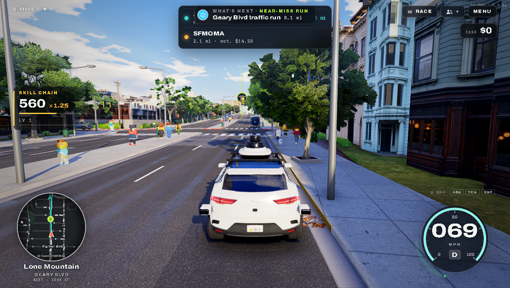

# TELEOPERATOR — offline mirror

Full mirror of **TELEOPERATOR** — the game is served by its own host,
**https://teleoperator.mindblown.ai** (route `/?mb=game`); the discovery URL
https://mindblown.ai/games/teleoperator is the publisher's portal, which embeds
the game in a cross-origin iframe.

Source: https://mindblown.ai/games/teleoperator



## Stack

- **Single esbuild bundle, WebGPU city drive** — the entry document loads
  `boot.js` (classic, device tier + crash recovery + early prefetch) then
  `app.js` (4,016,285 B, minified, built from a ~40-file module graph as the
  `taxi` variant: `SF_VARIANT='taxi'`, `SF_DIST`, `SF_MP`, `MB_GZ` globals).
  three.js powers the renderer through WebGPU (WGSL shaders; WebGL 1 is
  rejected since r163 — the og:description says "Real-time WebGPU")
- **Gzipped binary payload** — `data-gz` build: the city, vehicle and texture
  payloads are served as `<file>.gz` (`assets/real/*.bin.gz`, `*.glb.gz`);
  `boot.js` starts the downloads before the module graph is up, and
  `mindblown/assets.js` picks them up
- **Mindblown platform embed** — `__mb/app/` carries the PWA manifest, icons
  and the service worker (`mb-page-v1` cache); `api.mindblown.ai/pod.js`
  (data-game `0e37f38c-…`) and the portal chrome stay external
- **Plain static host** — no build step in the capture; the game document is
  served at `/?mb=game`, the bare `/` is the publisher's feed shell

## What this is

TELEOPERATOR (mindblown.ai/games/teleoperator; game host
teleoperator.mindblown.ai) — "Drive real San Francisco with friends: open a
room, send the link, everybody in their own robotaxi or supercar, their
mindblown name over it. Real-time WebGPU." Real San Francisco is rebuilt from
open data (OSM-derived roads, terrain, buildings, props and vegetation
binaries); you drive five cars (Waymo, Cybertruck, Ferrari 458, Corvette ZR1X,
Cybercab) in a Waymo-taxi mode with fares, street races, driving assists,
day/night and weather, photo mode — plus multiplayer rooms of up to 8 drivers
(`SF_MP`; the rooms terminate in the publisher's live brokers, which a static
mirror cannot carry).

The capture is the whole runtime closure the game host serves: **410 files,
171,250,625 bytes (163.3 MiB)** — entry document, the boot/bundle pair, the
stylesheet, the gzipped city and car payloads, the full audio tree, maps,
textures with baked lightmaps, fonts, the four workers and the `__mb/` platform
embed. Fetched 2026-10-12 across the fleet-wide network outage (two attempts
were killed mid-flight and resumed; the final fetch ran to closure — 283
requests, 0 gated, zero unresolved static paths; `/__mb/sound` is a POST-only
dynamic endpoint recorded in `_mirror-report.json`, and the cookie/localStorage
path in `index.html` covers the sound switch without it).

External, and staying external: `https://api.mindblown.ai/pod.js` (platform
pod: game config, events, sound sync), `https://mindblown.ai/embed/rail.js` +
`/embed/rail.css` + the session/items brokers + `/cookie-controls.js` (portal
multiplayer chrome — solo driving works without it), Google Tag Manager /
Analytics and the Facebook pixel (publisher chrome), and
`mindblown-prod-public.s3.us-east-1.amazonaws.com` (mindblown profile avatars).
Live multiplayer rooms are served by `api.mindblown.ai` and are not mirrorable.

## Layout

- `index.html` — the **game document** (39,043 B) as served at `/?mb=game`;
  this is the mirror's entry (a plain static server serves it at `/` and at
  `/?mb=game`)
- `shell.html` — the **feed shell** served at `/` (51,867 B): splash + rail +
  a same-origin iframe of `/?mb=game`; kept because the host serves it
- `shell-index.html` — the same shell as served at `/index.html` (51,907 B;
  identical but for its self-referential `twitter:player` meta) — the reason
  the entry document is probed through its real route, `/?mb=game`
- `app.js`, `boot.js`, `style.css`, `tune.json`, `slots.json`, `robots.txt`,
  `thumb.webp`, `icon.webp`, `apple-touch-icon.png` — the rest of the root
- `assets/`, `workers/`, `fonts/`, `__mb/app/` — the payload (see Assets)
- `.upstream/manifest.json` — sha256 for all 410 captured files (origin
  `https://teleoperator.mindblown.ai`)
- `_mirror-report.json` — capture record (283 requests, unresolved/unreachable
  notes)
- `readable/` — prettified derived layer (pinned prettier 3.9.6): 25 pretties
  (app, boot, style, `__mb/app/worker`, the four `workers/*.js` and the 17
  inline content blocks of the three documents) + `index-inline-map.json`
  (byte ranges + sha256)
- `src/` + `split-spec.json` — 417 statement-aligned slices recorded in 441
  derivation sections
- `tools/derive.mjs` — rebuild `readable/` + `src/` + `split-spec.json`
- `tools/verify.mjs` — re-hash the capture against the manifest
- `tools/update.mjs` — read-only drift probe against the live game host
- `tools/audit.js` — integrity gate for the derived layers (`AUDIT PASS`)
- `docs/cover.png`, `docs/boot-2026-10-13.png` — cover + boot evidence from
  the served mirror (actual gameplay)

## Assets

- **city data** — `assets/real/` (20 files, 25.9 MiB): `roads.bin.gz`,
  `terrain.bin.gz`, `buildings.bin.gz`, `props.bin.gz`, `ground.bin.gz`,
  `green.bin.gz`, `coast.bin.gz`, `rails.bin.gz`, `sky.bin.gz`,
  `sky_field.bin.gz`, `btags.bin.gz` + `marin/`, `west/`
- **audio** — `assets/audio/` (147 files, 32.7 MiB): `audio.json` + 146
  mp3/wav — engine and tyre loops (`ev_*`, `v12_*`, `dsl_*`, `sml_*`), brakes,
  horns, sirens (`cop_*`), city/bay beds, taxi chimes, `track_3.mp3`
- **textures** — `assets/tex/` (166 files, 50.5 MiB): the webp texture sets,
  `tex.json`, `impostors.json` and the baked lightmaps under
  `assets/tex/lm/{fortmason,lombard_gg,pier39,skyline,waterfront}/`
- **vehicles** — traffic in `assets/cars/` (bus, cablecar, hatch, pickup,
  sedan, suv, taxi, van — `*.glb.gz` + `*_lod1.glb.gz` + `*_2k.webp`); player
  cars `assets/waymo/` (7), `assets/cybercab/` (4), `assets/corvette/` (3),
  `assets/cybertruck/` (3); the garage turntable scene in `assets/car/` (7)
- **vegetation / lightmaps** — `assets/veg/` (trees, yards), `assets/lm/`
- **art** — `assets/plates.webp`, `assets/teleop_title{,_portrait,_square}.webp`,
  `thumb.webp`, `icon.webp`, `apple-touch-icon.png`
- **fonts** — `fonts/` (2): `Archivo-300-800.woff2`, `JetBrainsMono-600.woff2`
- **workers** — `workers/` (4): `car.js`, `img.js`, `lod.js`, `sky.js`
- **platform embed** — `__mb/app/` (5): `worker.js` (service worker),
  `manifest.webmanifest`, `icon-{180,192,512}.png`

## Run

Serve the repo root with any static file server (the capture is a static site;
no build step):

```
npx serve .
```

Open `http://localhost:3000/?mb=game` to boot the game (the entry route it is
served under upstream; `/` serves the same mirrored document from disk, while
the upstream `/` shell is preserved as `shell.html`).

## Verify

```
node tools/verify.mjs     # re-hash the capture against the manifest
node tools/audit.js       # derived-layer integrity gate
```

Last run: `410 files checked, 0 problems` and `AUDIT PASS` (441 spec sections,
417/417 src↔pretty round-trips byte-exact, 25/25 pretties re-render byte-exact
under pinned prettier 3.9.6, 17 inline content blocks with twins + map).

## Updating from upstream

```
node tools/update.mjs     # read-only drift probe: what changed upstream
```

The probe never rewrites the capture — a mirror is a point-in-time snapshot.
Route quirks it handles (re-verified 2026-10-13, byte-exact): the entry
document is probed at `/?mb=game` (GET `/index.html` answers with the shell,
captured as `shell-index.html`), and GET `/` answers with the feed shell
(`shell.html`). Known noise: `/__mb/sound` is POST-only (405 on GET) and stays
uncapturable by design. Refreshing means re-fetching the closure into a clean
tree and re-deriving `readable/` + `src/` with `node tools/derive.mjs`.

### 2026-10-12/13 derivation, closure and gates

The whole pipeline was cut from the recorded capture (capture bytes untouched —
`node tools/verify.mjs` re-hashes all 410 files), across the fleet-wide network
outage that killed two earlier fetch attempts mid-flight and forced the capture
to be resumed:

- `readable/` — pinned prettier 3.9.6 (module API, default options) rendered
  `app.js`, `boot.js`, `style.css`, `__mb/app/worker.js` and the four
  `workers/*.js`, plus the 17 inline content blocks of `index.html` (3),
  `shell.html` and `shell-index.html` (5 each → 7 files each, css/js) to 25
  pretties, with `index-inline-map.json` recording byte ranges + sha256 for the
  blocks. All 25 pretties re-render byte-exact under the pinned version.
- `src/` — 417 statement-aligned slices with exact 2-line provenance headers,
  recorded in `split-spec.json` (441 sections): 417/417 parse standalone
  (`node --input-type=module --check -`) and round-trip byte-exact to their
  readable line ranges. Vendor rule: `__mb/app/worker.js` is wholeFile, never
  sliced; 24 index-only wholeFile/skipped sections carry no src file.
- Closure — the served mirror was probed on loopback (entry document, the
  bundle, workers, audio, city binaries over HTTP 200; listener killed, port
  closed) and the live game host was cross-checked with the opencli browser's
  network log while actually driving (load log + gameplay log, audio tree
  included): every same-origin request is one of the 410 captured files, and
  the only off-origin hosts are the documented external ones above.
- Gates: `node tools/verify.mjs` → `410 files checked, 0 problems`;
  `node tools/audit.js` → `AUDIT PASS`; `node tools/derive.mjs` →
  self-check clean (0 orphans). Rebuild with `node tools/derive.mjs`.
- §0.4 fork-over-mirror checked 2026-10-13: neither the page nor any captured
  JS references a public source repo for the project — the only `github.com`
  strings in the whole capture are library credits (meshoptimizer, earcut,
  twemoji, and the OswaldFont/DancingScript/Archivo/JetBrainsMono font repos),
  and the in-game credits screen names its data sources, not a repository — so
  the mirror stands.

## Mirror conventions

- **Capture layer** — the captured files are byte-exact copies of what the
  origin served; nothing in them is edited. Gzipped payloads stay `.gz` exactly
  as served — never decompressed or re-compressed.
- **Readable layer** — `readable/` is derived (prettified) and never shipped to
  a browser; it exists so the bundles can actually be read.
- **Provenance** — `.upstream/manifest.json` records sha256 for each captured
  artifact, and `tools/verify.mjs` re-checks it.
- **Drift** — `tools/update.mjs` is read-only: it reports what changed upstream
  and never rewrites the capture.
- **Route divergence (recorded)** — upstream `/` is the publisher's feed shell
  and the game document lives at `/?mb=game`; the mirror's disk root is the
  game document (`index.html`), and both shell documents are preserved as
  `shell.html` / `shell-index.html`.

## Fleet status

<!-- mirror-status:start — feeds _standard/REPO-INDEX.md. Update ONLY your own mirror's block; never edit the shared index (PLAN §8). Rebuild: node _standard/build-index.mjs -->
<!-- cols: cls=classification · ver=verify 0 problems · upd=drift probe · man=manifest · rdbl=readable re-derived · src=reversed src · boot=boot test · top=offline-mirror topic · tag=backup tag · staged=staged not committed -->
| # | repo | cls | ver | upd | man | rdbl | src | boot | top | tag | staged |
|---|---|---|---|---|---|---|---|---|---|---|---|
| 0 | teleoperator | mirror | ✓ | ✓ | ✓ | ✓ | ✓ | ✓ | ✓ | — | — |
<!-- mirror-status:end -->
